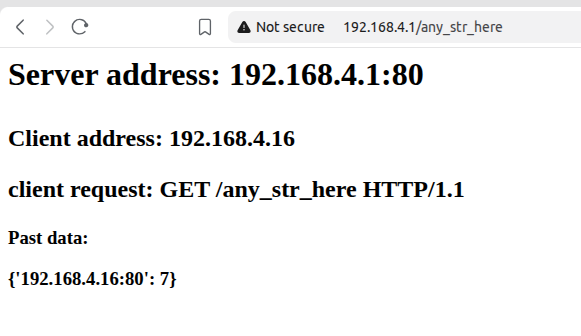

# Micro Python. Pico W Access Point (AP) on Raspberry Pi Pico W (RPI)


## Usage

Use it if you need devices on the same Wi-Fi network and do not care about security.
It can be done with Wi-Fi extender if you configure access point with the same name and password. 

I made this for Pepelats audio looper that runs HTTP server to show its status. With the help of this AP
any connected phone or tablet can display it.
The Wi-Fi SSID is 'picoweb' and password is '88888888' 


## Extensibility

The AP layer is protocol-agnostic. Any TCP (or UDP) protocol can run
on top of it — just bind a different port and implement framing.

For example, the same setup can serve as a **MIDI over Wi-Fi**
bridge (RFC 1048 / RTP-MIDI on port 5004) or custom protocol between two devices.   

## Prerequisites

- Raspberry Pi Pico W (W - means Wi-Fi)
- Micro-USB cable (data, not just charging)
- Python3 installed and module pip installed
- Using pip install mpremote - command line tool for MicroPython devices. 
  ``` bash
  pip install --user mpremote
  ```
 
## Prepare RPI

### Flash firmware

- Go to https://micropython.org/download/RPI_PICO_W
- Download RPI_PICO_W-<version>.uf2 (take latest stable version)
- Hold the BOOTSEL button on the RPI and plug into USB
- Release BOOTSEL — RPI drive appears
- Copy RPI_PICO_W-<version>.uf2 onto RPI drive
- The Pico reboots automatically (drive disappears)


### Copy code
- Plug RPI not holding the button, you will see no RPI drive 
- Use mpremote to copy and list the file on RPI:
   ```bash
   mpremote cp main.py :
   mpremote ls
   ```

## Run Access Point
- Plug RPI into 5V power adapter and see the green LED goes on
- From another device connect to 'picoweb' Wi-Fi, password '88888888'
- Open 'http://192.168.4.1' and see server information

In browser AP history has IP address: count of requests:




